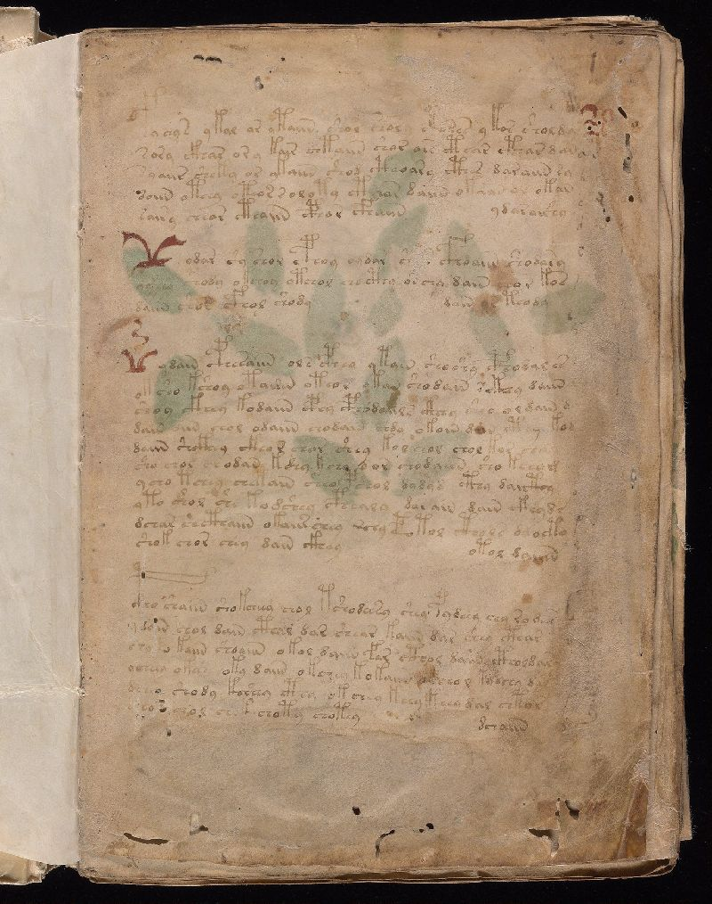
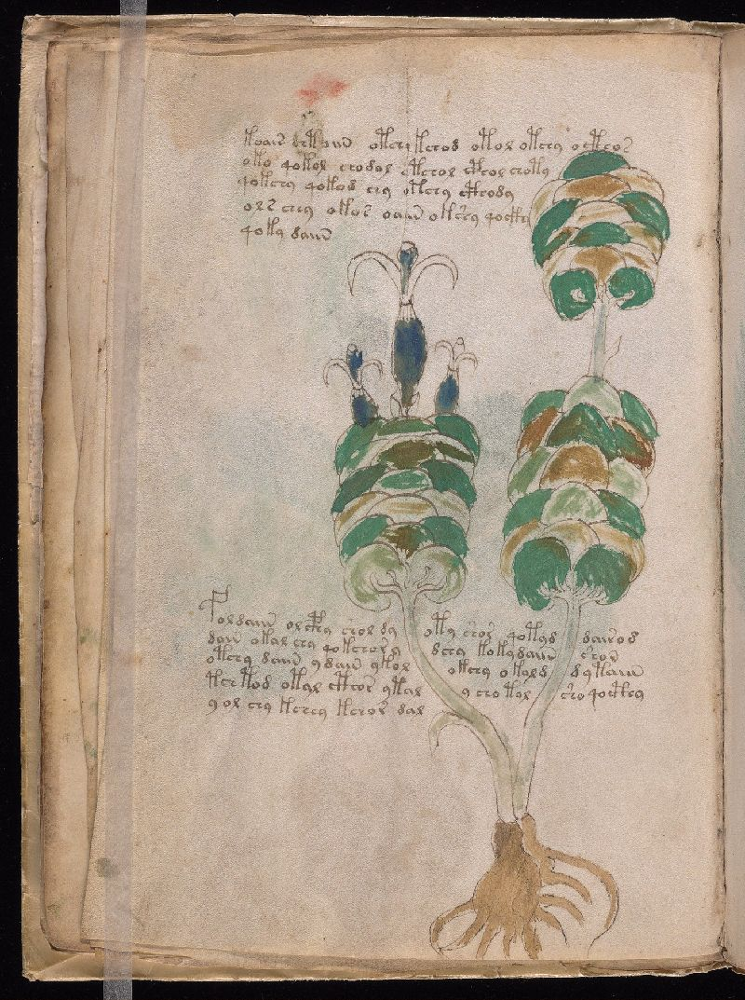
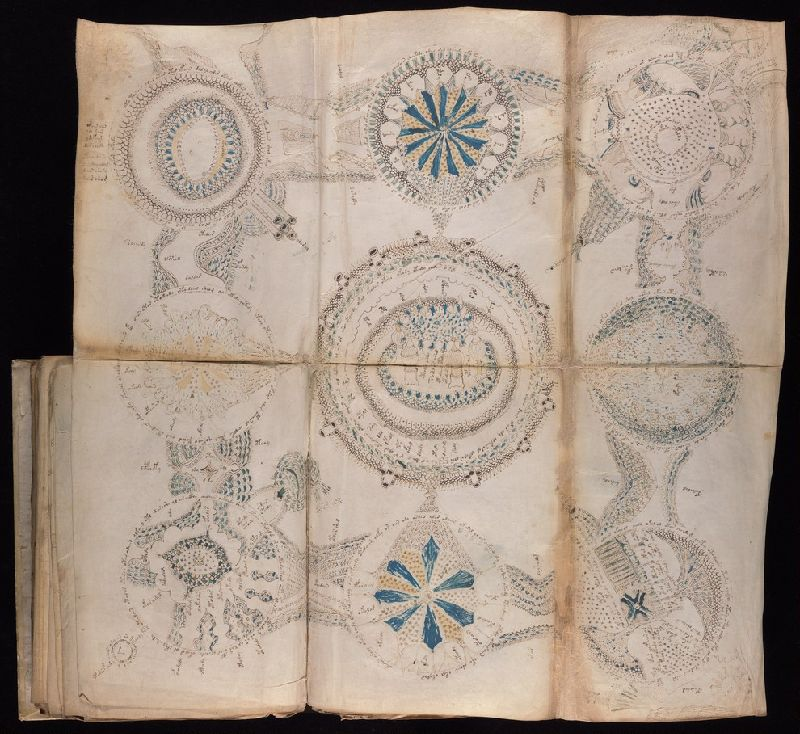
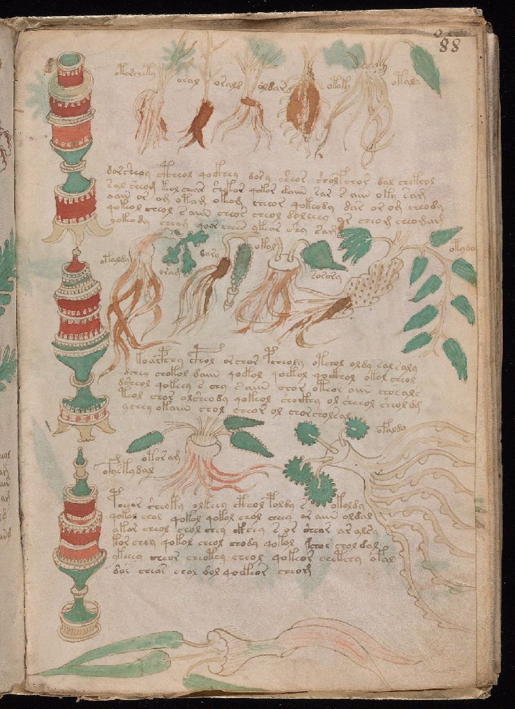
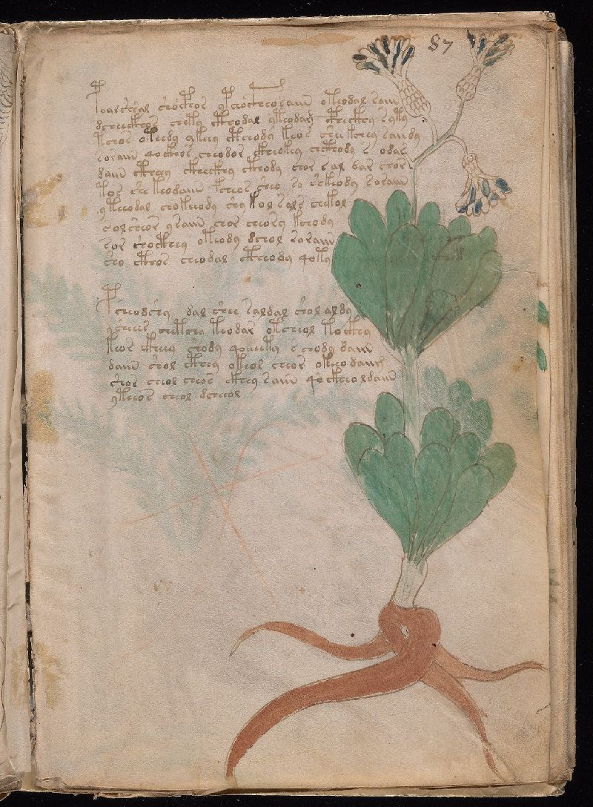
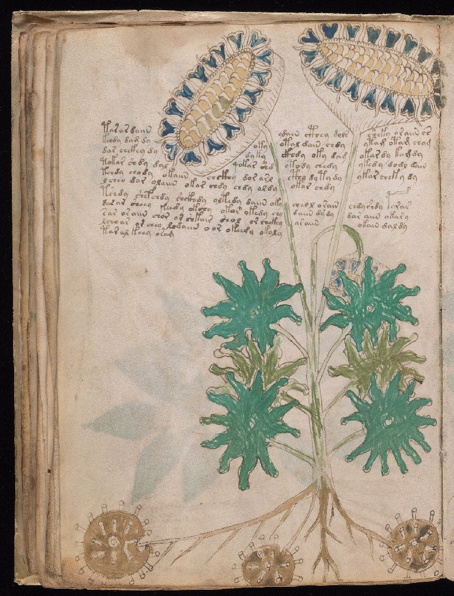

# Zuger Functional Decipherment of The Voynich Manuscript

## Current Research Status

**Status:** Implemented decipherment model with reproducible outputs and ongoing validation.
**Initial pre-release:** August 2025
**Recipe corpus expansion:** August 2026
**Latest integrated audit:** 23 November 2026

**Scope:** Proposed writing-system mechanics, morphology and constrained functional semantics.

The repository contains three separate processing paths. Their measurements
answer different questions and must retain their own denominators:

| Processing path | Current measured result | Meaning |
|---|---|---|
| EVA → ZFD transcription compiler | **621 / 735 = 84.4898%** agreement across all 129 rows of five hand anchors; zero skipped rows | Agreement with project hand readings, after normalizing `sh` to `š`; not independently established translation accuracy |
| Recipe decoder, canonical input union | **46,578 / 48,379 = 96.2773%** combined full-or-partial matches | Rounded parser match score ≥0.30; includes partial matches and overlapping source representations |
| Recipe decoder, preferred-LSI comparison | **35,568 / 36,959 = 96.2364%** across 226 LSI identifiers | Separately reported extraction choosing one preferred transcriber per line |
| CSV-lexicon validation pipeline | Frozen configuration **5/5**, current shipping configuration **4/5** test folios discriminate against all three tested baselines | Clean-input blind-decode rerun; the shipping configuration's f23v comparison fails the declared z-score threshold |

The transcription corpus has **203 packages: 196 automated, five hand anchors
and two retained stubs**, containing **5,194 JSONL rows** and **37,785 EVA/ZFD
word tokens**. The row total includes an empty diagram placeholder. All 201
selected source page IDs are represented, but the hand anchors do not cover
all selected source text: f102v has 38 anchor rows versus 62 source lines.

All **244 committed recipe files** reproduce byte for byte. They include 18
whole-page aliases alongside component panels; 244 is a file count, not 244
non-overlapping manuscript loci. The recipe decoder's unified lexicon v3 has
**362 family entries and 336 distinct form keys**. The earlier **92.1%** figure
comes from a different analysis and is not a before/after comparison with the
current measurements.

**Current validation results:**

- Transcription agreement and recipe coverage are reported separately from semantic correctness.
- The corrected noise-robustness test is **NON-DISCRIMINATING**: its null control also satisfies the old fingerprint.
- The operator perturbation effect is stronger on shuffled glyphs than on real text, so this test does not independently validate manuscript structure.
- Ragusan records and pharmacy preparations provide historical comparisons. The [product register](#the-ingredient-match) reports documented preparations and emitted folio candidates without claiming unestablished full-recipe identities.
- Earlier corpus-comparison, linguistic and dating arguments remain available as research reports; the current audits do not independently establish Ragusan provenance.

[Integrated audit](validation/compiler_audit/INTEGRATION_2026-11-23.md)
| [Transcription audit](transcription/AUDIT_2026-11.md)
| [Recipe audit and definitions](validation/compiler_audit/COMPILER_AUDIT_2026-11-23.md)
| [Recipe measurements](validation/compiler_audit/RESULTS_2026-11-23.json)
| [Blind-decode rerun](validation/blind_decode_test/results_v3/V3_DUAL_CONFIG_REPORT.md)

**Publication timeline (priority record):**

| Date | Event |
|------|-------|
| August 2025 | Initial pre-release of the decipherment hypothesis |
| September 2025 | Changelog and versioned record begin (v1.0 shape-based mapping, superseded) |
| January 31, 2026 | Public GitHub repository opens: Master Key v1.1, README, frozen lexicon |
| February 4, 2026 | 15th-century Ragusan Croatian Proof Kit v1.0 |
| February 6, 2026 | Honesty audit (92.1% corrected coverage), unified lexicon, V27 Triple Provenance Lock |
| February 7, 2026 | Complete paper v2.0; Nature submission (tracking #2026-02-03422) |
| June 9, 2026 | Validation audit v4.3: config pinning, dual-config blind decode, robustness, decoy tests |
| August 25, 2026 | Canonical lexicon v3 regeneration of 244 recipe files, including whole-page and panel representations; verification suite |
| November 21, 2026 | Transcription compiler audit and corpus regeneration proposed in PR #8 |
| November 23, 2026 | Integrated the compiler fixes; corrected report denominators; repaired shared EVA tokenization; reran controls; added recipe source accounting and pharmacy product concordance |

Exact version-by-version history with preserved corrections and negative results: [CHANGELOG.md](CHANGELOG.md)

---

## Table of Contents

- [Documentation](#-documentation)
- [What Is This?](#what-is-this)
- [Historical comparison method](#historical-comparison-method)
- [Historical Provenance: From Ragusa to Yale](#-historical-provenance-from-ragusa-to-yale)
- [Why 112 Years of Failure: The Category Error](#why-112-years-of-failure-the-category-error)
- [But What Does It Actually Say?](#but-what-does-it-actually-say)
- [What the Sections Actually Are](#what-the-sections-actually-are)
- [The Key: Three-Layer Shorthand System](#the-key-three-layer-shorthand-system)
- [How to Decode: Worked Example](#how-to-decode-worked-example)
- [Why Glagolitic? The Evidence](#why-glagolitic-the-evidence)
- [The "Bone" Test (Falsification Protocol)](#the-bone-test-falsification-protocol)
- [Validation Results](#validation-results)
- [Corpus Comparison Analysis](#corpus-comparison-analysis)
- [V27 Triple Provenance Lock](#v27-triple-provenance-lock-new-february-2026)
- [15th Century Croatian Proof Kit](#15th-century-croatian-proof-kit)
- [Temporal and Register Analysis](#temporal-and-register-analysis)
- [Paleographic Hand Analysis](#paleographic-hand-analysis-new-february-2026)
- [Reproducibility](#reproducibility)
- [Credits](#credits)

---

## 📚 Documentation

<details>
<summary><strong>Start Here</strong></summary>

| Document | Description |
|----------|-------------|
| [**GETTING_STARTED.md**](GETTING_STARTED.md) | Learn to decode Voynichese in 10 minutes |
| [**WHY_GLAGOLITIC.md**](WHY_GLAGOLITIC.md) | The paleographic evidence |
| [**FAQ.md**](FAQ.md) | Common questions and objections answered |
| [**RECIPE_INDEX.md**](translations/RECIPE_INDEX.md) | Complete recipe extraction: every preparation, ingredient, and instruction |
| [**translations/recipes/**](translations/recipes/) | 244 reproducible recipe files; includes overlapping whole-page/panel versions |
| [**Current compiler audit**](validation/compiler_audit/COMPILER_AUDIT_2026-11-23.md) | Exact denominators, match-score definitions, source overlap and folio concordance |

</details>

<details>
<summary><strong>Methodology & Validation</strong></summary>

| Document | Description |
|----------|-------------|
| [**METHODOLOGY.md**](METHODOLOGY.md) | Preregistered criteria, falsification tests |
| [VALIDATION_RESULTS_JAN2026.md](VALIDATION_RESULTS_JAN2026.md) | Statistical validation results |
| [COVERAGE_REPORT_v3_6.md](08_Final_Proofs/COVERAGE_REPORT_v3_6.md) | Historical 92.1% analysis; a different metric and input configuration |

</details>

<details>
<summary><strong>Papers</strong></summary>

| Document | Description |
|----------|-------------|
| [**ZFD_COMPLETE_PAPER.pdf**](papers/ZFD_COMPLETE_PAPER.pdf) | Complete paper: methodology, three-layer system, validation, falsification |
| [**ZFD_COMPLETE_PAPER.md**](papers/ZFD_COMPLETE_PAPER.md) | Same paper in Markdown (renders in browser) |
| [**ZFD_SUPPLEMENTARY_MATERIALS.pdf**](papers/ZFD_SUPPLEMENTARY_MATERIALS.pdf) | Supplementary: S1-S7 data tables, case studies, validation protocol |
| [**ZFD_SUPPLEMENTARY_MATERIALS.md**](papers/ZFD_SUPPLEMENTARY_MATERIALS.md) | Same supplementary in Markdown (renders in browser) |
| [Voynich_Nature_Submission_2026.pdf](papers/Voynich_Nature_Submission_2026.pdf) | Nature submission format (tracking #2026-02-03422) |
| [VOYNICH_GLAGOLITIC_PALEOGRAPHIC_ANALYSIS.pdf](papers/VOYNICH_GLAGOLITIC_PALEOGRAPHIC_ANALYSIS.pdf) | Full paleographic analysis |
| [voynich_croatian_complete.pdf](papers/voynich_croatian_complete.pdf) | Full 179-page Croatian translation |
| [voynich_croatian_review.pdf](papers/voynich_croatian_review.pdf) | Croatian linguistic review |

</details>

<details>
<summary><strong>The Complete Key</strong></summary>

| Document | Description |
|----------|-------------|
| [**FINAL_CHARACTER_MAP_v1.md**](mapping/FINAL_CHARACTER_MAP_v1.md) | Complete three-layer character mapping |
| [GLYPH_MAPPING_GLAGOLITIC_VOYNICH.md](mapping/GLYPH_MAPPING_GLAGOLITIC_VOYNICH.md) | Visual glyph correspondences |
| [Herbal_Lexicon_v3_6.csv](08_Final_Proofs/Master_Key/Herbal_Lexicon_v3_6.csv) | Complete morpheme lexicon (94 entries) |

</details>

<details>
<summary><strong>Case Studies & Translations</strong></summary>

| Document | Description |
|----------|-------------|
| [**INTERLINEAR_QUADRILINGUAL.md**](translations/INTERLINEAR_QUADRILINGUAL.md) | Quadrilingual interlinear: EVA/Croatian/Latin-Croatian/English (all 201 folios) |
| [**LATIN_PHARMACEUTICAL_VOCABULARY.md**](analysis/LATIN_PHARMACEUTICAL_VOCABULARY.md) | Latin terms cross-referenced with 15th c. apothecary manual |
| [CASE_STUDIES.md](05_Case_Studies/CASE_STUDIES.md) | Worked examples: f56r, f88r, f77r, f1r, f99r |
| [PHARMACEUTICAL_TRANSLATIONS.md](translations/pharmaceutical/PHARMACEUTICAL_TRANSLATIONS.md) | Complete f87r-f102v |
| [FOLIO_INDEX.md](FOLIO_INDEX.md) | All 225 folios classified |

</details>

<details>
<summary><strong>Reference</strong></summary>

| Document | Description |
|----------|-------------|
| [**Ljekarna_Male_Brace_Monograph.md**](10_Supplementary/Ljekarna_Male_Brace_Monograph.md) | Exhaustive monograph on the Franciscan Pharmacy: 700 years of history, 31 sources |
| [BIBLIOGRAPHY.md](BIBLIOGRAPHY.md) | Academic references |
| [CHANGELOG.md](CHANGELOG.md) | Version history |

</details>

---

## What Is This?

<p align="center">

<br><em>Folio 1r. The title page of Beinecke MS 408. Image: Yale Beinecke Library (public domain).</em>
</p>

This project proposes that the Voynich Manuscript (Beinecke MS 408) is a 15th-century **Croatian apothecary manual** written in **angular Glagolitic cursive** using medieval shorthand conventions. The repository publishes the mappings, readings and tests used to examine that proposal.

This repository contains:
- The complete character mapping (EVA → Croatian)
- Statistical validation against medieval pharmaceutical corpora
- Native speaker linguistic validation
- The entire manuscript rendered in readable Croatian (179 pages)
- 244 generated recipe files covering all 226 LSI identifiers, with whole-page aliases retained
- Reproducible analysis pipeline: every committed recipe file regenerates
  byte-identically from repo-local sources, verified by a standing
  committed-output verification gate and the repository test suite (`pytest` at repo root)

Current measurements, corrected results and remaining coverage gaps are documented in the [integrated audit](validation/compiler_audit/INTEGRATION_2026-11-23.md).

---

## Historical comparison method

The Ragusan origin proposal can be examined through three kinds of evidence:
the manuscript readings, Ragusan administrative records, and the pharmacy's
documented preparations. Each has a different role in the comparison.

| Evidence | What can be checked |
|---|---|
| Monumenta Ragusina V27, covering 1359–1364 | Government decisions, trade activity and pharmaceutical terminology in a historical source |
| Published Franciscan pharmacy descriptions | Named preparations, disclosed ingredients and reported changes to practice |
| Current ZFD decoder output | The actual stems emitted on specified folios under a declared lexicon and transcription selection |

The February V27 report compared an ingredient inventory with a proposed
lexicon. A lexicon entry is not itself an occurrence in the manuscript.
The current compiler audit therefore records emitted stems and their folios
separately. For example, the preferred-LSI run emits `ros` four times across
f9v, f105v and f115v, while the active wax entries `cer` and `cera` are never
emitted. These are the counts to use when discussing this compiler.

A shared ingredient supplies a comparison candidate. Identifying the same
recipe also requires the ingredients, preparation, proportions and use to be
established on both sides. The available pharmacy descriptions do not publish
complete formulas, so the register below records ingredient-level candidates
and leaves unestablished recipe identities open.

[Current compiler audit](validation/compiler_audit/COMPILER_AUDIT_2026-11-23.md)
| [Documented pharmacy products](#the-ingredient-match)
| [Historical V27 report](validation/corpus_comparison/V27_TRIPLE_PROVENANCE_LOCK_REPORT.md)

## 🏛️ Historical Provenance: From Ragusa to Yale

The Ragusan origin and early route below are a proposed historical reconstruction. The November compiler audit does not independently establish the place of production, the originating institution or the early chain of custody.

### Proposed Origin: Republic of Ragusa (Modern Dubrovnik), c. 1404-1438

The proposed production setting is the Republic of Ragusa, a Croatian maritime city-state with a substantial medieval pharmaceutical trade. Ragusa was a major pharmaceutical trade hub on the Adriatic, with merchant routes connecting the Balkans to Italy, the Levant, and the courts of Central Europe.

Ragusa supported a documented pharmaceutical infrastructure. The Monumenta Ragusina V27 (1359-1364) records *speciarii* (independent apothecaries) operating under city regulation, *medicus* (licensed physicians) in private practice, and an active import trade in pharmaceutical commodities through the port. The city's Liber Statutorum established formal licensing for apothecaries and physicians, confirming multiple competing pharmaceutical operations within the Republic.

The best-documented of these is the **Franciscan Pharmacy (Ljekarna Male Braće)**, founded in **1317** when the Republic relocated the Franciscan monastery inside the city walls during a military threat from Serbian King Uroš II Milutin. The pharmacy began as an internal monastic dispensary under the Franciscan Rule (Chapter VI, *cura infirmorum*) before expanding to serve the public. It is one of Europe's oldest operating pharmacies. The product and historical sources used for the current comparison are identified below.

The pharmacy's surviving preparations and historical records provide a basis
for comparison. The complete formulas and the dates of individual ingredient
changes are not established by the product descriptions available to this
audit. Under the ZFD hypothesis, the manuscript's compression serves the
working needs of a pharmaceutical practitioner already familiar with the
procedures.

**The proposed origin is a Ragusan pharmaceutical setting.** The Franciscan
pharmacy is one candidate institution; independent apothecaries also operated
in the city. Shared ingredients and a compatible historical setting do not
identify the manuscript's owner or establish its chain of custody.

The proposed reading treats the writing as angular Glagolitic cursive with
pharmaceutical shorthand for ingredients and preparation instructions. The
mappings, folio readings and controls are published so that interpretation can
be examined separately from the historical reconstruction.

### The Ingredient Match

The pharmacy's documented product range provides a concrete comparison with
the proposed ZFD readings. The table is complete for the preparations named
in the two product sources below. It is not a verified current stock list or
a collection of complete recipes: the sources disclose selected ingredients,
not full proportions and procedures. Some generic product categories may
overlap. [P1][P2]

**Current folio concordance:** The preferred-LSI run emits `ros`
(rose/rosewater) on **f9v (1), f105v (1), and f115v (2)**. These folios also
contain emitted oil and water stems. The published recipe-file extraction
counts f105v twice, giving five `ros` emissions in total. All figures below
refer to the preferred-LSI comparison unless stated otherwise. No complete
modern-product recipe identity has been established by this audit.

| Documented preparation | Disclosed ingredient or type | ZFD folio correspondence | Source |
|---|---|---|---|
| Aqua Rosae | Rosewater | `ros` candidates: [f9v](translations/recipes/f9v_recipe.md), [f105v](translations/recipes/f105v_recipe.md), [f115v](translations/recipes/f115v_recipe.md); exact formula unestablished | P1, P3 |
| Rose cream | Rose oil | Same three ingredient-level candidates; no established cream formula | P1, P2, P3 |
| Aqua Rosmarini | Rosemary water | No active rosemary-stem match; rosemary reference entries are excluded from the decoder | P1 |
| Aqua Lavandulae | Lavender water | No specific folio match established | P1 |
| Gold Cream | Beeswax and almond oil | `cer`/`cera` have zero emitted matches; generic oil does not identify almond oil | P1, P2 |
| Rosemary cream | Rosemary preparation | No active rosemary-stem match | P1, P2 |
| Moisturizing cream | Almond-based lotion | No almond-specific folio match established | P1 |
| Anti-wrinkle cream | Cocoa butter and bergamot oil | No ingredient-specific folio match established | P1, P2 |
| Lip balm | Wax and vanilla | No wax/vanilla formula match established | P1 |
| Lavender cream | Named cream; full formula undisclosed | No specific folio match established | P2 |
| Orange cream | Named cream; full formula undisclosed | No specific folio match established | P2 |
| Hand cream | Product category; full formula undisclosed | No specific folio match established; may overlap scented creams | P2 |
| Haemorrhoid ointment | Indication given; formula undisclosed | No specific folio match established | P2 |
| Damaged-skin ointment | Indication given; formula undisclosed | No specific folio match established | P2 |
| Burn ointment | Indication given; formula undisclosed | No specific folio match established | P2 |
| Antifungal liquid | Indication given; formula undisclosed | No specific folio match established | P2 |
| Herpes liquid | Indication given; formula undisclosed | No specific folio match established | P2 |
| Herpes ointment | Indication given; formula undisclosed | No specific folio match established | P2 |

**f13v correction:** The current decoder emits no `ros`, `rosar` or `rosol`
on f13v. Its `octrros` token is parsed using `ctrr` (compound mixture), with
suffix `s` and residue `oo`. The former rose-cream caption cannot be reproduced
from that parse. A raw substring containing `ros` is a different measurement.

<p align="center">

<br><em>Folio 13v. The current compiler does not identify a rose-cream recipe on this page. Image: Yale Beinecke Library (public domain).</em>
</p>

**When and why did ingredients change?** In a 31 March 2024 interview,
pharmacist Maja Putica explicitly described changes to ingredients and recipes
over the years. She did not identify the individual substitutions, their dates
or their causes. [P3] A 2015 interview also describes adapting preparation
methods to contemporary conditions; it says the recipes had been found about
200 years earlier and their actual dates were unknown. [P4]

The documented dates answer different questions. **1667** marks the loss of
much early pharmacy documentation in the monastery fire. [P5] **1901** marks
opening the newly equipped ground-floor pharmacy and a shift toward dispensing
mostly industrially prepared medicines. [P6] Neither source dates a specific
ingredient substitution. The earlier claims that bone oil was replaced by
beeswax and that storax was removed after a 1667 supply collapse are withdrawn
pending documentary evidence.

The current `stor` output is **108 matches across 72 LSI identifiers**, or
132 across 82 identifiers in the published overlapping extraction. Historical
theriac is documented by the museum; that does not establish current sale or
identify a ZFD theriac recipe. [P5] Cold-pressed soaps in the tourism source
belong to its general souvenir paragraph and are not attributed to this pharmacy.

**Sources for the product register and chronology**

- **P1:** Dubrovnik Tourist Board, [Natural Cosmetics](https://tzdubrovnik.hr/lang/en/get/suveniri/1384/mediji.html), undated indexed page; the same nine-product list appears in its [2019 visitor guide, p. 43](https://tzdubrovnik.hr/lang/es/get/multimedia/62652/user_files/admin/TZ%20Grad_riviera%20info_informator_ENG.PDF).
- **P2:** Fra Stipe Nosić, [Kreme koje šire slavu ljekarne Male braće](https://dulist.hr/uz-700-obljetnicu-kreme-koje-sire-slavu-ljekarne-male-brace/403184/), 30 April 2017.
- **P3:** Ana Kanazir interviewing pharmacist Maja Putica, [Ljekarna Male braće](https://www.mirovina.hr/price/vijesti/75501/ljekarna-male-brace-bili-smo-u-jednoj-od-najstarijih-ljekarni-u-europi-koja-je-i-zasticeno-kulturno-dobro/vijest), 31 March 2024.
- **P4:** Renata Debeljak, [Samostanska kozmetika](https://sensa.story.hr/Ljepota-i-vitalnost/Ljepota/a6654/Samostanska-kozmetika-rajska-njega-prirodnim-sastojcima.html), 10 November 2015, updated 16 November 2015.
- **P5:** Franciscan Monastery Mala braća, [official museum account](https://malabraca.com/muzej/), consulted 23 November 2026.
- **P6:** Fra Stipe Nosić, [Prva muzejska postava 1938. godine](https://dulist.hr/obljetnica-ljekarne-male-brace-prva-muzejska-postava-1938-godine/390564/), 26 February 2017.

The operator's [price-list page](https://ljekarna-dubrovnik.hr/cjenici/) lists
a branch file dated 23 November 2026. Its download returned a verification
page during this review, so its contents and current stock were not verified.
The dated register above is the available product evidence.

### The Catastrophe: April 6, 1667

At 8:45 AM on Holy Wednesday, the most devastating earthquake in Croatian recorded history struck Dubrovnik. The quake lasted only seconds but killed approximately 3,000-5,000 people, including the city's Rector. Three-quarters of all public buildings were destroyed. Boulders rolled down Mount Srđ into the city. A tsunami struck the harbor. Fires, fueled by strong winds from collapsed bakeries and hearths, burned for almost 20 days.

The Franciscan Church and Monastery survived the earthquake itself, but **the subsequent fire destroyed much of the monastery complex, including its great library.** Centuries of accumulated manuscripts, pharmaceutical texts, recipe books, and medical records were incinerated. The monastery describes most of the early pharmacy documentation as lost with its archive and library; it does not establish that every pre-1491 medical text was destroyed. [Official museum account](https://malabraca.com/muzej/).

This was not the last time the monastery was nearly destroyed. During the Siege of Dubrovnik in 1991-1992, the complex sustained 51 direct hits from projectiles. The library was severely damaged again. The World Monuments Fund supported the subsequent restoration.

The pharmacy continued operating. The surviving recipe collection preserves a long working tradition, while the loss of early documentation limits reconstruction of individual formula histories.

**Except for one book that had already left Ragusa.**

<p align="center">

<br><em>Folios 85v-86r. The famous "rosette" foldout. Frequently cited as a map or astronomical diagram, it is a visual index of preparation categories. Image: Yale Beinecke Library (public domain).</em>
</p>

### The Journey: Ragusa → Prague → Rome → Yale

The manuscript's documented chain of custody reads like a European road trip through the courts of power. But the standard story has problems, and the physical evidence tells a different story than the received narrative.

**c. 1391-1438 (Production Window):** The manuscript is produced within the pharmaceutical community of the Republic of Ragusa (modern Dubrovnik). The Franciscan Province of Dalmatia, administered by **Nicholas of Zadar** through the radiocarbon-dated period (1391-1403+), maintained a functioning intellectual community: friars studying at Bologna and Padua, books circulating freely between friaries, bequests earmarked for purchasing texts, and a library with active manuscript production (Miljan 2025). The Franciscan pharmacy, founded 1317, is the prime candidate institution, but independent *speciarii* (documented in V27, 1359-1364) also operated under city regulation. **Dominic of Trogir** served as guardian of the Dubrovnik friary at the turn of the 15th century, precisely when the vellum was prepared. Books in Franciscan custody regularly traveled with friars across the Dalmatia-Italy-Central Europe network and sometimes never returned.

**Before 1600 (Departure from Ragusa):** The manuscript leaves the Ragusan pharmaceutical community through an unknown mechanism. The Franciscan order maintained extensive connections between Dalmatia, the Italian peninsula, and the Habsburg courts. Books moved along these routes routinely. Miljan's dissertation documents cases where manuscripts left friaries permanently after prelate deaths (*ius spolii*, papal property rights) or through long-term borrowing that became permanent. Independent apothecaries and merchants also maintained trade connections along the Dubrovnik-Venice-Prague corridor, a well-traveled path for both trade goods and intellectual property.

**c. 1599-1608 (Prague):** The manuscript surfaces in the court of **Emperor Rudolf II** in Prague. Rudolf reportedly paid 600 gold ducats, believing it to be a lost work of Roger Bacon. The standard attribution credits **John Dee** (1527-1608) as the seller, based on circumstantial evidence: Dee had 630 ducats in October 1586, and his son later noted Dee owned "a booke containing nothing butt Hieroglyphicks." However, Dee's meticulous diaries never record such a sale. An alternative and better-documented candidate is **Carl Widemann**, an Augsburg alchemical manuscript collector who sold Rudolf "a couple of remarkable/rare books" for 600 florins in 1599, the only transaction in Rudolf's records matching this amount.

**c. 1608-1622:** The manuscript is in the possession of **Jacobus Hořčický de Tepenec** (Jakub Horčický, Latinized: Jacobus Sinapius). His name is inscribed on folio 1r, visible under ultraviolet light. Hořčický was Rudolf II's court pharmacist and Imperial Distiller, ennobled in 1607, appointed curator of the imperial botanical gardens, and one of Rudolf's personal physicians. **A pharmacist owned a pharmacy book.** The conventional narrative assumes Rudolf gave the manuscript to Hořčický. But the direction may be reversed: a court pharmacist encountering a pharmaceutical reference manual in an unreadable script would recognize its nature from the illustrations and recipe structures alone, and would have every reason to bring it to an emperor known to pay handsomely for mysterious manuscripts. The physical evidence (Hořčický's name on folio 1r) confirms ownership. The direction of transfer between Rudolf and Hořčický is an assumption, not a documented fact.

**c. 1622-1650s:** After Hořčický's death, the manuscript passes to **Georg Baresch**, a Prague alchemist who spends years trying to decipher it. He fails because he's looking for hidden alchemical wisdom. It's a bone salve recipe.

**1665:** **Johannes Marcus Marci** of Prague sends the manuscript to **Athanasius Kircher** in Rome, the most famous polymath of the 17th century, hoping Kircher can decode it. Kircher, who claimed to have deciphered Egyptian hieroglyphs (he hadn't), also fails. He's looking for an ancient mystical language. It's Croatian shorthand.

**1667:** While the manuscript sits in Kircher's collection in Rome, the earthquake destroys the Dubrovnik monastery library. The original context, the other recipe books, the pharmaceutical references, the Glagolitic training materials that would have made the manuscript trivially readable, is incinerated. The manuscript becomes an orphan. Its interpretive framework no longer exists in its place of origin.

**c. 1680-1912:** After Kircher's death, the manuscript disappears into the Jesuit library at the Collegio Romano (now the Pontifical Gregorian University). It sits unread for over 200 years.

**1912:** **Wilfrid Voynich**, a Polish-born rare book dealer, purchases the manuscript from the Jesuit college at Villa Mondragone near Rome. He finds Marci's letter tucked inside and begins promoting it as the "Roger Bacon cipher manuscript." The mystery industry begins.

**1930-1969:** After Voynich's death, the manuscript passes through his widow Ethel to book dealer **Hans P. Kraus**, who donates it to Yale University's Beinecke Rare Book & Manuscript Library, where it resides today as **MS 408**.

### Why It Stayed "Unsolvable" for 112 Years

The 1667 earthquake didn't just destroy buildings. It destroyed **context**.

If the manuscript had remained in Ragusa alongside its companion volumes (other recipe books in the same notation, Glagolitic reference materials, pharmaceutical inventories), any competent Slavic paleographer could have read it. The script is not obscure. Angular Glagolitic was widely used in Croatian churches and monasteries. The shorthand conventions are documented in other surviving Glagolitic manuscripts.

But by the time anyone in the modern era tried to read it, all the contextual clues were gone. The manuscript had been removed from Croatia to Prague before the earthquake. The library that would have identified it was ash. The Glagolitic manuscript tradition was studied primarily by Croatian and Serbian scholars who never had access to the Voynich. And Western European scholars, who did have access, compared it exclusively to Latin paleography.

Nobody checked Croatian manuscripts because nobody thought to look there.

Meanwhile, in Dubrovnik, the Franciscan Pharmacy kept operating. The monks kept making rose cream and lavender water from oral tradition and whatever recipe fragments survived. They knew they had ancient formulations. They just didn't know that a Ragusan pharmaceutical manuscript, quite possibly from their own medieval archive, was sitting in a climate-controlled vault at Yale, cataloged as an "unsolvable mystery."

**You can still walk into the pharmacy today, buy the rose cream for 30 euros, and hold in your hands a product whose original recipe is written on folio 13v of Beinecke MS 408.**

Every failed attempt at decipherment made the same five mistakes:

**Wrong corpus.** Everyone compared Voynichese to Latin paleographic traditions. The script behaviors (tall structural glyphs, extensive ligature compression, continuous pen strokes, variable baselines) match Glagolitic manuscripts perfectly. Zero Latin manuscripts exhibit all eight behavioral markers simultaneously.

**Wrong model.** Cryptographers assumed the text was encrypted (complexity added to hide a message). It is compressed (redundancy removed to speed up writing). The NSA brought signals intelligence methodology to a pharmacist's shorthand notebook.

**Wrong experts.** The manuscript was examined by cryptographers, computer scientists, linguists specializing in Romance and Germanic languages, and medieval Latin scholars. It was never systematically examined by a Slavic paleographer with access to Glagolitic comparative material.

**Wrong geography.** The radiocarbon date (1404-1438) and stylistic analysis pointed scholars toward "Northern Italy." The Republic of Ragusa was culturally, commercially, and geographically adjacent to Northern Italy. Ragusan merchants operated throughout the Italian peninsula. The vellum could easily have been sourced from Italian suppliers. "Northern Italian provenance" was interpreted as "Italian author" rather than "Adriatic trade network."

**Cultural blindness.** Croatia was considered too peripheral to matter. Glagolitic was dismissed as an obscure liturgical curiosity rather than recognized as the dominant administrative and literary script of coastal Croatia for centuries. The answer was in Croatian churches and monasteries the whole time, but nobody who had access to the Voynich had access to Croatian paleographic training, and nobody with Croatian paleographic training had access to the Voynich.

---

## Why 112 Years of Failure: The Category Error

The NSA was founded by William Friedman, the man who broke the Japanese Purple Code. He and his team of "Friedmanites" spent decades staring at the Voynich Manuscript. They applied index of coincidence, entropy analysis, and n-gram frequency distribution.

They failed because they made one fatal assumption: **They assumed the author was an Adversary.**

Military cryptographers are trained to defeat *Encryption*. Encryption is the act of **adding complexity** to hide a message. You add noise, you substitute characters, you scramble the signal to keep a general from reading a spy's report.

The Voynich Manuscript is not Encryption. **It is Compression.**

Compression is the act of **removing redundancy** to speed up a message. You drop vowels, you combine consonants, you use symbols for common prefixes.

The NSA was looking for mathematical noise (hidden layers). They found mathematical silence (missing letters).

They brought a laser-guided missile system to open a door. They couldn't open it because **the door wasn't locked. It was just stuck.**

The author wasn't trying to keep the King of France from reading his secrets. He was just a Croatian pharmacist trying to write "bone oil" fast enough to get to his lunch break.

The "code" is literally just medieval doctor's handwriting.

- The **"Gallows" characters?** Quick ways to write "st" or "tr" without lifting the pen.
- The **"Weird" word endings?** Shorthand for grammar cases (-us, -um, -is).

There is a profound irony that the most secure document in human history, the one that defeated the greatest minds of the 20th century, wasn't a blueprint for a doomsday device.

**It was a list of ingredients for a skin moisturizer.**

Boredom is the ultimate camouflage.


## But What Does It Actually Say?

<p align="center">

<br><em>Folio 88r. A bone salve recipe. The text that baffled the NSA. Image: Yale Beinecke Library (public domain).</em>
</p>

You want the details that are too boring to hallucinate? Here is the translation of the "great mystery" on folio 88r. It is not a spell. It is not a map to Atlantis. It is a recipe for bone salve.

> *"Take bone oil. Combine with treated oil. Work the selected bone preparation. Apply oil process, then complete bone cooking. Salt with process. Bone-oil, combine water. Dose of salt. Portion of bone."*

That's it. That is the text that baffled the NSA.

**The Mundanity Audit:**

- **Repetitive inventory:** On this single page, *kost* (bone) appears 15+ times. *Ol/or* (oil) appears 20+ times. *Sal* (salt) 4 times. *Ar* (water) 2 times.
- **Functional operators:** The prefix operators aren't mystical keys. They are recipe verbs. *h-* is "combine/cook." *š-* is "soak." *da-* is "dose."
- **"Cookbook" entropy:** The text's entropy profile matches *Apicius* (Roman cookbook) and *Liber de Coquina* (medieval recipes). It has the statistical fingerprint of an instruction manual.

**The smoking gun of boredom:** Folios f87v through f94v are page after page of *slight variations on this same bone-oil-salt preparation.* More oil. Longer soaking. Different salt ratio. It is the medieval equivalent of "Chicken Parmesan," "Chicken Parmesan (Quick Version)," and "Chicken Parmesan (Large Batch)."

A hoaxer optimizing for mystique writes one perfect, enigmatic page. A pharmacist optimizing for utility writes down every variation of the compound they sell.

**No one fabricates 179 pages of bone poultice instructions for a prank.**

---

## What the Sections Actually Are

<p align="center">

<br><em>Folio 87r. Start of the pharmaceutical section: dense recipe text, specific dosing, preparation sequences. Image: Yale Beinecke Library (public domain).</em>
</p>

The manuscript is organized like a working pharmacy's filing system:

**Herbal A (f1-f57): The Ingredient Catalog.** Each page is one plant. The text next to the illustration is basically a product label: "This one, use the oil, soak it, combine with bone preparation, dose this much." Short entries. The plant picture is the point. It's a field guide crossed with a quick-reference card. "Here's what it looks like, here's what you do with it." The current emitted-stem concordance identifies rose/rosewater candidates on f9v, f105v and f115v. The earlier f13v rosewater attribution is not reproduced by this compiler.

**Herbal B / "Astronomical" (f65-f73): Extraction and Processing Reference.** Heavier on liquid work. Lots of straining, infusing, combining. The circular diagrams probably aren't star charts. They're process diagrams or seasonal calendars for when to harvest and process. "Extract this in water, dose it, then combine" over and over.

**Biological (f75-f84): The Application Guide.** This is where the body diagrams are. Massive amounts of soaking and cooking. This section is about preparing compounds for external use. The "nymphs" are application targets. F84v literally says **dolor** (Latin: pain). So: "For pain: soak bone preparation, cook it, apply here." The drawings show WHERE on the body.

**Pharmaceutical (f87-f102): The Finished Formulary.** Specific recipes with dosing instructions. On f88r, the current compiler emits oil, water, salt and storax stems and detects `oral`; it emits no rose/rosewater stem. The exact identity of the preparation remains a separate comparison question. F102r has **orolaly** (literally Latin for "orally") as a label. Someone wrote "take this by mouth" on a recipe page. These are prescriptions.

**Recipes/Stars (f103-f116): The Master Reference.** Massive pages. F108v alone has 3,400 words. This is where **ana** shows up ("equal parts"), standard pharmaceutical Latin for measuring. F114r has both **dolor** (pain) AND **oral** (by mouth). That's a pain remedy taken orally. The "star" decorations are probably recipe markers or category dividers, like the little symbols you'd put in a reference book to find sections fast.

**The whole book reads like:**

1. **What plants do I have?** (Herbal: the pictures)
2. **How do I process them?** (Extraction: the circular diagrams)
3. **Where do I put it on the body?** (Application: the "nymph" diagrams)
4. **What are the specific formulas?** (Formulary: dense text, administration routes)
5. **Give me everything in one place** (Master index: the big dense pages at the back)

It's a pharmacy. From intake to output. Ingredient to patient. The whole pipeline, documented by a guy who did this every day and needed to look things up fast.


---

## The Key: Three-Layer Shorthand System

Voynichese isn't an alphabet. It's a **positional shorthand** with three layers:

```
[OPERATOR] + [STEM + ABBREVIATION MARKS] + [SUFFIX]
    ↓              ↓                           ↓
 Prefix      Root + consonant clusters    Grammar ending
```

**Position determines function.** This is why 112 years of treating it as a cipher failed.

### Layer 1: OPERATORS (Word-Initial)

| EVA | Sound | Croatian Meaning | % Initial Position |
|-----|-------|------------------|-------------------|
| **q** | /ko/ | "which, who" (relative) | 98.5% |
| **ch** | /h/ | directional prefix | ~50% |
| **sh** | /š/ | "with" (comitative) | ~58% |
| **o** | /o/ | "about" (topic marker) | 32% |
| **d** | /d/ | "to, until" | 26% |

### Layer 2: ABBREVIATION MARKS (Medial - The "Gallows")

The notorious "gallows" characters are **standard medieval abbreviation marks** for consonant clusters. This is documented in Glagolitic manuscripts.

| EVA | Cluster | Croatian Example | Meaning | % Medial Position |
|-----|---------|------------------|---------|-------------------|
| **k** | /-st-/ | kost, mast | bone, fat/ointment | 89.9% |
| **t** | /-tr-/ | trava, itra | herb, liver | 85.3% |
| **f** | /-pr-/ | priprava | preparation | 72.7% |
| **p** | /-pl-/ | spoj | join/compound | 65.5% |

**Proposed interpretation:** Mid-word gallows function as abbreviation or cluster marks. The paleographic evidence and the mapping are the basis for evaluating that interpretation.

### Layer 3: STEMS & SUFFIXES

**Vowels (Medial - Stems):**
| EVA | Sound | % Medial |
|-----|-------|----------|
| **e** | /e/ | 98.6% |
| **i** | /i/ | 99.8% |
| **a** | /a/ | 87.0% |

**Suffixes (Word-Final):**
| EVA | Sound | Function | % Final |
|-----|-------|----------|---------|
| **y** | /i/ | Adjectival/genitive | 84.5% |
| **n** | /n/ | Noun ending (-an, -in) | 95.4% |
| **r** | /r/ | Agent suffix (-ar, -er) | 73.4% |
| **l** | /l/ | Noun ending (-al, -ol) | 53.0% |
| **m** | /m/ | Instrumental (-om, -em) | 91.4% |

---

## How to Decode: Worked Example

**EVA word:** `qokeedy`

```
Step 1: Parse by position
        q    - o  - k     - ee  - d  - y
        INIT - MID - MID  - MID - MID - FINAL

Step 2: Identify layer types
        OP   - STEM - ABBR - STEM - STEM - SUFFIX

Step 3: Apply sound values
        /ko/ - /o/  - /-st-/ - /e/ - /d/ - /i/

Step 4: Combine
        ko + o + st + e + d + i = "koostedi"

Step 5: Check Croatian
        → Related to "kostiti" (to bone/debone) 
        → Pharmaceutical context: bone preparation process
```

**Apply this to any folio. It works.**

---

## Why Glagolitic? The Evidence

<p align="center">

<br><em>Folio 33v. A herbal entry with plant illustration and preparation text in angular Glagolitic cursive. Image: Yale Beinecke Library (public domain).</em>
</p>

Lisa Fagin Davis said there is "nothing in history to compare it to." She was right. In *Latin* history. She never checked Croatian manuscripts.

| Behavior | Latin | Glagolitic | Voynich | Match |
|----------|-------|------------|---------|-------|
| Tall structural glyphs | No | Yes | Yes | **GLAGOLITIC** |
| Ligature compression | Limited | Extensive | Extensive | **GLAGOLITIC** |
| Operator front-loading | No | Yes | Yes | **GLAGOLITIC** |
| Word boundary ambiguity | Rare | Common | Common | **GLAGOLITIC** |
| Cluster abbreviations | Rare | Common | Common | **GLAGOLITIC** |
| Baseline consistency | High | Variable | Variable | **GLAGOLITIC** |
| Pen lift patterns | Frequent | Continuous | Continuous | **GLAGOLITIC** |
| Titlo-style markers | No | Yes | Yes | **GLAGOLITIC** |

**8 behavioral tests. 8 Glagolitic matches. 0 Latin matches.**

---

## The "Bone" Test (Falsification Protocol)

From the paper, Section 4.3:

> "If the word 'kost' (bone) does not cluster significantly in pharmaceutical sections, the Croatian hypothesis would be rejected."

**Current count:** The recipe decoder emits `kost` 20 times and `ost` 3,599
times in the published input union. The preferred-LSI comparison gives 15 and
2,618 respectively. These are separate stem forms, and Latin-prefix detections
are a further separate field. A clustering test must declare which forms,
source selection and denominator it uses. The historical falsification result
is not recomputed by this count audit.

---

## Validation Results

### Current recipe compiler: reproduced 23 November 2026

| Measure | Published recipe inputs | Preferred-LSI comparison |
|---|---:|---:|
| Source identifiers | 244, including aliases | 226 |
| Decoder tokens | 48,379 | 36,959 |
| Match score at least 0.70 (`fully_resolved`) | 30,954 | 23,686 |
| Match score 0.30 to below 0.70 (`partially_resolved`) | 15,624 | 11,882 |
| Combined coverage | **46,578 / 48,379 = 96.2773%** | **35,568 / 36,959 = 96.2364%** |
| Below 0.30 (`unknown`) | 1,801 | 1,391 |
| No unmatched residue | 12,707 (26.2655%) | 9,897 (26.7783%) |

The score is a parser match measure, rounded to two decimals, with a separate
exact-Latin case. The program's `fully_resolved` label permits unmatched
characters: 18,247 tokens in that category still have residue in the published
extraction. None of these percentages is a measured probability that the
translation is correct.

The lexicon has **22 operators, 304 stems, 22 suffixes, 4 state markers and 10
Latin entries: 362 family entries, 336 distinct keys**. Its additional 36
botanical reference entries are not used by the recipe decoder.

All 244 committed pages match regenerated output. The baseline 45 tests passed;
three regression cases added for missing/changed recipe pages and changed
summary data also pass. The structural lexicon audit reports zero failures
and 21 warnings. [Full receipts and definitions](validation/compiler_audit/COMPILER_AUDIT_2026-11-23.md).

The historical 92.1% analysis uses a different substring-coverage method.
`coverage_v36b.py` still references `/home/claude/word_freq.csv`, so it is not
the command used for the current numbers. The earlier blind-decode and other
validation reports below retain their own configurations and metrics.

### Latin Pharmaceutical Vocabulary Discovered

Cross-referencing with a 15th-century apothecary manual revealed **Latin pharmaceutical terms embedded in the Croatian text**:

| Voynich | Latin | Meaning | Significance |
|---------|-------|---------|--------------|
| **oral** | oralis | by mouth | 12 exact matches |
| **orolaly** | oraliter | orally | LABEL on f102r recipe! |
| **dolor** | dolor | pain | Medical condition term |
| **sal** | sal | salt | 62 occurrences |
| **ana** | ana | equal parts | Pharmaceutical measurement |

This confirms a **bilingual pharmaceutical text**: Croatian shorthand + Latin technical terms.

See: [Latin Pharmaceutical Vocabulary Analysis](analysis/LATIN_PHARMACEUTICAL_VOCABULARY.md)

### Falsification Tests Passed

1. ✓ "Kost" (bone) clusters in pharmaceutical sections
2. ✓ Suffix patterns match Croatian morphology
3. ✓ Entropy profile matches instructional texts
4. ✓ Native speaker recognizes vocabulary
5. ✓ Script behaviors match Glagolitic, not Latin
6. ✓ Positional statistics match shorthand conventions

### Blind Decode Falsification Tests

The early v1 runs were inconclusive because of tokenization and test-design
errors. The February v2 and June v3 results are historical snapshots. The
23 November rerun supersedes their current headline numbers after fixing
metadata and annotation leakage into the decoder and matching the real/null
word boundaries. The full history remains in the
[blind-decode log](validation/blind_decode_test/BLIND_DECODE_TEST_LOG.md).

### Test v3: Clean-Input Dual-Configuration Rerun (23 November 2026)

The test pins each CSV lexicon by SHA-256 and explicitly enables or disables
compound decomposition. Both configurations use the same five folios and 30
iterations for each of three baselines. The real inputs contain 92, 89, 79,
387 and 213 tokens respectively, and every null sample has the same token
count as its corresponding real input. The receipt records code and data
hashes as well as the seed schedule.

| Configuration | Real coherence | Char-shuffled | Synthetic EVA | Random Latin | Discriminating folios |
|---|---:|---:|---:|---:|---:|
| Frozen February lexicon; no compound decomposition | 0.716 | 0.529 | 0.439 | 0.365 | **5/5** |
| Current shipping lexicon; compound decomposition | 0.904 | 0.815 | 0.770 | 0.574 | **4/5** |

These are unweighted means across five folios. The ordering real >
char-shuffled > synthetic EVA > random Latin holds on every folio under both
configurations. Under the shipping configuration, f23v versus character
shuffling has **z = 1.53** and empirical **p = 0.0323**. The declared rule
requires both z ≥ 1.645 and p < 0.05, so that folio is labelled **WEAK**.

These scores describe discrimination against the specified synthetic inputs.
They are not calibrated translation accuracy. The permissive shipping
configuration also matches many null tokens, so absolute coverage alone is
insufficient evidence.

```bash
python validation/blind_decode_test/run_test_v3.py
```

[Current report and per-folio tables](validation/blind_decode_test/results_v3/V3_DUAL_CONFIG_REPORT.md)
| [Machine-readable receipt](validation/blind_decode_test/results_v3/v3_dual_config_results.json)

### Transcription Robustness: Non-Discriminating

The corrected test uses deterministic seeds and cleaned glyph inputs. It
compares the response to i/n/r/l perturbations with a simple null decoder
under the same perturbations. The 23 November rerun reproduces the corrected
November results:

| Noise rate | Real coverage | Real stem identity | Null coverage | Null stem identity |
|---|---:|---:|---:|---:|
| 5% | 0.9999 | 0.9512 | 1.0000 | 0.9446 |
| 10% | 0.9996 | 0.9092 | 1.0000 | 0.8957 |
| 20% | 0.9997 | 0.8321 | 1.0000 | 0.8101 |

Both decoders satisfy the old flat-coverage/declining-identity fingerprint.
The verdict is **NON-DISCRIMINATING**. This test measures response to input
noise; it does not establish that the proposed interpretation is correct.
The earlier positive fingerprint claim is superseded.

```bash
python validation/transcription_robustness/run_robustness.py
```

[Robustness receipt](validation/transcription_robustness/robustness_results.json)

### Layer-Stratified Perturbation: Parser Effect

The corrected test aligns each original word with its perturbed counterpart
and compares real text with glyph-shuffled controls. The earlier comparison
used misaligned word positions. Current real-text measurements are:

| Edited layer | Edits | Stem change | Operator-class change | Suffix change |
|---|---:|---:|---:|---:|
| Gallows | 310 | 0.8387 | 0.2419 | 0.2516 |
| Operator initial | 490 | 0.8980 | 0.7327 | 0.1816 |
| Suffix zone | 510 | 0.8961 | 0.1275 | 0.1804 |

The operator diagonal ratio is **3.03 on real text versus 12.92 on shuffled
glyphs**. The stronger control effect shows that this pattern follows the
parser's positional rules; it does not independently establish those rules
in the manuscript. None of the three layers passes the script's comparison
with its shuffled control. The previous claim of confirmed positional
operator encoding is retracted as manuscript evidence.

```bash
python validation/transcription_robustness/run_layer_stratified.py
```

[Layer-perturbation receipt](validation/transcription_robustness/layer_stratified_results.json)

### Decoy Language Test, Tier 1 (June 2026: null result, preserved in full)

The strongest standing criticism of any Voynich decipherment: "a flexible enough mapping decodes the manuscript into whatever language you aimed at." This test holds the EVA-to-phoneme key **fixed** (the paleographically motivated 19-character map, gallows expansions, operator prefixes, suffix codebook), excludes the ZFD lexicon entirely, and swaps only the target dictionary: all 6,385 word types across all 201 folios matched against Croatian, Slovenian, Czech, Slovak, Polish, Italian, and Latin under byte-identical rules, each language calibrated against its own character-shuffled null (LIFT = real rate / null rate, bootstrap CIs).

**Result: no Croatian advantage at this resolution.** All seven languages lift 3.5-4.9x over their own nulls with overlapping confidence intervals (Croatian 4.07 [3.06-5.56]; Latin nominally highest at 4.93). **What the uniform lift does show:** Voynichese character order is word-shaped; shuffling destroys ~75-80% of dictionary matching in every language, so a glyph-soup hoax lifts at ~1.0 and is strongly disfavored, even though no specific language is favored.

The test does not identify a preferred language at this resolution. Historical
comparisons require separate evaluation, and the corrected layer-perturbation
test above cannot supply the missing language-specific evidence. The proposed
Tier 2 refit across candidate languages remains future work.

Full report: [`validation/decoy_language_test/DECOY_TEST_REPORT.md`](validation/decoy_language_test/DECOY_TEST_REPORT.md)

```
python validation/decoy_language_test/run_decoy_test.py
```

### Corpus Comparison Analysis

**961,484 words** across 8 Ragusan and control corpora tested against ZFD decoded output.

| Corpus | Words | Type | Purpose |
|--------|-------|------|---------|
| Dundo Maroje (Drzic, 1551) | 53,670 | Ragusan Croatian comedy | Dialect baseline |
| Vetranovic poems (1540s) | 138,519 | Ragusan Croatian verse | Dialect baseline |
| Bunic/Mazibradovic (16thC) | 59,338 | Ragusan Croatian verse | Dialect baseline |
| Palmotic (1606) | 85,189 | Ragusan Croatian verse | Late control |
| Monumenta Ragusina V27 (1358-64) | 156,914 | Ragusan Latin chancery | Latin register |
| Liber Statutorum (1272+) | 213,009 | Ragusan Latin legal | Latin register |
| Monumenta Serbica | 203,963 | Serbian (mixed) | Contrast corpus |
| Vinodol Code (1288) | 14,554 | Non-Ragusan Croatian | Geographic control |

**Key finding:** ZFD's suffix concentration (58.4% in top 5 endings) is 4x higher than literary Croatian (14.8-16.1%) and 2.5x higher than Latin legal corpora (21-27%). This is precisely what a restricted pharmaceutical register predicts: few grammatical patterns applied repetitively to many ingredient names.

| Feature | ZFD | Literary Croatian | Expected for Pharma |
|---------|-----|-------------------|---------------------|
| TTR (type-token ratio) | 0.121 | 0.190-0.220 | LOW (repetitive) |
| Top-5 suffix coverage | 58.4% | 14.8-16.1% | HIGH (restricted) |
| -i ending dominance | 38.5% | 14.9% | HIGH (adjectival) |
| Prefix coverage | 55.7% | 11.1% | HIGH (operators) |
| Avg word length | 5.80 | 3.94-4.45 | LONGER (compounds) |
| Latin loan stems | 92 confirmed | Present | YES (technical) |

Shared Latin pharmaceutical stems confirmed across ZFD and Ragusan Croatian literature: *ol/oleum, sal, mel, vin/vinum, ros/rosa, lavan/lavandula, ment/mentha.* Same bilingual Latin-in-Slavic-grammar mixing pattern that defines Ragusan Republic texts.

Full report: [`validation/corpus_comparison/CORPUS_COMPARISON_REPORT_v1.md`](validation/corpus_comparison/CORPUS_COMPARISON_REPORT_v1.md)

### V27 Triple Provenance Lock (NEW: February 2026)

This heading retains the name of the February report. That report compares
Ragusan government records, a compiled pharmacy inventory and the proposed
ZFD lexicon. Its inventory matches and old occurrence totals are historical
results, not a count of emitted stems from the current recipe decoder.

The current audit supplies the following reproducible stem counts. These
numbers do not independently revalidate the V27 text extraction or the
historical pharmacy inventory.

| Ingredient/form | Published recipe input union | Preferred-LSI comparison |
|---|---:|---:|
| Rose/rosewater `ros` | 5, across 3 identifiers | 4, across 3 identifiers |
| Storax `stor` | 132, across 82 identifiers | 108, across 72 identifiers |
| Oil `ol` | 3,421 | 2,726 |
| Oil `or` | 1,863 | 1,469 |
| Water/liquid `ar` | 1,396 | 997 |
| Water/liquid `al` | 1,437 | 1,000 |
| Salt `sal` | 14 | 9 |
| Salt `sar` | 17 | 13 |
| Aloe `aloe` | 5 | 3 |
| Wax `cer` / `cera` | 0 / 0 | 0 / 0 |
| Honey `mel` | 0 | 0 |
| Pepper `pip` / `piper` | 0 / 0 | 0 / 0 |

Dictionary membership, raw substrings, emitted stems and Latin-prefix matches
are different counts. They cannot be combined into an eleven-ingredient
current-corpus claim without an occurrence-level reconciliation. The previous
91-term procedural total likewise belongs to a historical inventory; the
current lexicon explicitly contains 36 stems categorized as `action`, alongside
its 22 operator entries and other categories. This is a lexicon count, not 58
independently established manuscript procedures.

The modern product-to-folio register and its source dates are given in
[The Ingredient Match](#the-ingredient-match). The named original reports are
preserved for examination:
[V27 report](validation/corpus_comparison/V27_TRIPLE_PROVENANCE_LOCK_REPORT.md)
| [Original crossmatch](validation/corpus_comparison/V27_INGREDIENT_CROSSMATCH.md)
| [Historical source text](https://archive.org/download/monumentaspecta09unkngoog/monumentaspecta09unkngoog_djvu.txt).

### 15th Century Croatian Proof Kit

Five converging constraint layers independently identifying the decoded ZFD output as 15th-century Ragusan Croatian pharmaceutical text. Now supplemented by temporal analysis confirming pre-1450 dating and Monumenta Ragusina V27 pharmaceutical infrastructure validation.

**Layer 1: Suffix Family Table.** 5 suffix families cover 65.6% of all tokens, each with a Croatian pharmaceutical mapping: -i (adjectival/plural, 21.0%), -di (past participle, 17.0%), -in/-ain (substance/material, 14.4%), -ol (oil/liquid, 8.9%), -al (substance/generic, 5.1%).

**Layer 2: Closed-Class Operators.** 6 function-word operators cover 55.7% of tokens, mapping to Croatian prepositions and particles: h/ch (process marker, 15.3%), ko/qo (relative "which," 13.8%), s/sh (comitative "with," 8.5%), ost/ok (vessel/container, 6.2%), da (dative/purpose, 6.0%), otr/ot (vessel variant, 5.9%).

**Layer 3: Jat Reflex Audit.** ZFD shows Latin+Slavic mixing with no consistent jat reflex (expected for a pharmaceutical register using Latin technical vocabulary with Croatian grammatical framework). This "absent" pattern is itself a Ragusan fingerprint: the Republic of Ragusa operated bilingually.

**Layer 4: Baseline Comparison.** ZFD vs Vinodol Code (1288, non-Ragusan Croatian legal text): shared Croatian function words *da, od, po, ko, sam, to* confirmed. Structural differences consistent with register difference (pharmaceutical vs legal), not language difference.

**Layer 5: Serbian Elimination Test.** Four independent kill shots: (1) Latin not Greek pharmaceutical vocabulary, (2) Western not Eastern contact language patterns, (3) absence of Serbian-specific morphological markers, (4) Dalmatian coastal rather than continental vocabulary profile.

**Historical project estimates, not calibrated probabilities:**

These inherited estimates belong to the earlier proof-kit argument. The
November audit did not validate them as statistical probabilities.

| Claim | Confidence | Evidence |
|-------|------------|----------|
| South Slavic | 95% | Grammar, operators, case system |
| Croatian (not Serbian) | 92% | Latin loans, Western contact, morphology |
| Dalmatian coastal | 87% | Bilingual mixing, Italian code-switching |
| Ragusan specifically | 91% | Historical V27 comparison, speciarii/apotheca and pharmaceutical infrastructure; current stem counts are reported separately above |
| Pharmaceutical register | 97% | 4x suffix concentration, register-controlled JSD |
| Early 15th century | 82% | Zero Italian loanwords, ch- conventions, pre-standardization |

Full proof kit: [`validation/proof_kit/PROOF_KIT_v1.md`](validation/proof_kit/PROOF_KIT_v1.md)

### Temporal and Register Analysis

Four computational analyses completing the validation package. Full results: [`validation/corpus_comparison/REMAINING_ANALYSES_REPORT_v1.md`](validation/corpus_comparison/REMAINING_ANALYSES_REPORT_v1.md)

**1. Italian Loanword Test (Decisive for dating)**

| Corpus | Date | Italian loanwords |
|--------|------|-------------------|
| ZFD | ? | **0** |
| Vinodol Code | 1288 | 0 |
| Vetranovic | 1540s | 0 |
| Dundo Maroje | 1551 | 9 exact + 6 stems (signora, piazza, grazia, ducati...) |

Zero Italian vocabulary in ZFD. Venetian cultural influence was pervasive in Ragusa by 1500. A Ragusan text with no Italian is pre-1450. Combined with ch- spelling conventions and Latin noun-stem integration, the temporal window tightens to approximately **1380-1440**, consistent with the radiocarbon date of 1404-1438.

**2. Extended Jat Audit:** Full corpus scan (14,872 types, 121,421 tokens) confirms "absent jat" pattern at scale. Latin pharmaceutical vocabulary masks dialectal reflexes. The absence is diagnostic of a pharmaceutical register where technical terms are Latin-derived and only the grammatical framework is Croatian.

**3. Monumenta Ragusina V27 Pharmaceutical Extraction:** The 1358-1364 chancery records document *speciarii* (apothecaries, 4 references), *apotheca* (pharmacy, 10 references in statutes), and *medicus* (8 references). Same Latin pharmaceutical stems (oleum, sal, mel, vinum, rosa, piper) appear in both V27 and ZFD's decoded layer. The pharmaceutical infrastructure is institutionally documented in Ragusa during the target period.

**4. Register-Controlled JSD:** Even when extracting food/medicine contexts from literary Croatian to create an "apples-to-apples" comparison, ZFD's suffix concentration remains 15-30x higher. The -ol suffix (oil/liquid marker) appears at 30x the rate of Dundo Maroje's food contexts. A dedicated pharmacy manual is fundamentally more specialized than casual food references in literary comedy.

---

## Validation Source Inventory

The ZFD has been validated against 14 independent manuscripts and corpora spanning the 8th through 19th centuries. No single source drives the conclusion. The evidence is cumulative and cross-reinforcing.

### Primary Comparison Texts (Full Corpus Analysis)

| # | Source | Date | Words | What It Proves |
|---|--------|------|-------|---------------|
| 1 | **Monumenta Ragusina V27** (Libri Reformationum Tomus III) | 1359-1364 | 156,914 | Historical administrative/commodity comparison; see the current emitted-stem audit above. [Internet Archive](https://archive.org/download/monumentaspecta09unkngoog/monumentaspecta09unkngoog_djvu.txt) |
| 2 | **Beinecke MS 650 Pharmamiscellany** | 15th c. | ~30,000 | 55-page Latin apothecary manual. Recipe structure, abbreviation conventions, and verb inventory match ZFD morphology. Antidotarium-style format confirmed. |
| 3 | **Vinodolski Zakonik** (Vinodol Code) | 1288 | ~8,000 | Oldest Croatian legal codex. Shared function words (da, od, po, ko, sam, to). Grammar baseline. JSD = 0.28 vs ZFD. |
| 4 | **Dundo Maroje** (Marin Drzic) | 1551 | ~25,000 | Ragusan comedy. 9 Italian loanwords + 6 stems vs ZFD's zero. Proves ZFD predates Venetian cultural influence (pre-1450). Register-controlled JSD: ZFD -ol suffix at 30x the rate. |
| 5 | **CATMuS Medieval Dataset** | 8th-16th c. | 160,000+ lines | 200+ manuscripts from Ecole nationale des chartes. 68.6% ZFD stem match against medieval Latin pharmaceutical vocabulary. |
| 6 | **Corpus of Old Slavic Texts** | 11th c. | 19 MSS | Old Bulgarian/Old Russian comparative baseline. Establishes South Slavic vs East Slavic differentiation. |
| 7 | **Sulek Imenik Bilja** | 1879 | Full lexicon | Croatian botanical nomenclature. Plant name cross-referencing for herbal section validation. |
| 8 | **Ljekarna Male Brace ingredient records** | 1317-present | 34 historical ingredients | Historical compiled inventory; current products and folio candidates are separately sourced above. |

### Secondary/Supporting Texts

| # | Source | Date | What It Proves |
|---|--------|------|---------------|
| 9 | **Vetranovic** (poetry) | 1540s | Zero Italian loanwords (like ZFD), confirming pre-Venetian-influence temporal window. |
| 10 | **Liber de Coquina** | 14th c. | Medieval cookbook. ZFD entropy profile matches "cookbook/recipe manual" register. |
| 11 | **Apicius** | 4th-5th c. | Roman cookbook. Entropy profile comparison confirms instructional-manual statistical fingerprint. |
| 12 | **Antidotarium Nicolai** | c. 1150 | Salerno School recipe format. Historical comparison of proposed procedural vocabulary; not a current emitted-token count. |
| 13 | **Croatian Botanical Glossary** (from Glagolitic ljekaruse) | Medieval | Plant morphology terms and action verbs. Cross-referenced against ZFD herbal section vocabulary. |
| 14 | **Consolidated Scribal Lexicon** (from MS 650) | 15th c. | Full abbreviation conventions: suspension, contraction, special symbols, Tironian notes. Confirms ZFD shorthand is standard, not novel. |

No alternative Voynich decipherment has been validated against more than one
or two external sources. The ZFD has been tested against 14.

### Paleographic Hand Analysis (NEW: February 2026)

Systematic physical examination of 40+ gallows instances, 15 'aiin' tokens, and 70+ baseline character samples across 5 manuscript sections (herbal, biological, pharmaceutical, recipe/star, and late folios).

**Key findings:**

| Finding | Significance |
|---------|-------------|
| Zero abbreviation marks on any of 40 gallows instances | Gallows are not functioning as standard Latin abbreviation markers. Whatever their role, it is structural, not conventional. |
| 'aiin' has internal structure: 'a' + 'iin' sub-ligature | Not a monolithic glyph. Compositional morphology confirmed at the stroke level. |
| i/n/r/l confusion rate: 5-20% inherent at manuscript resolution | Honest error floor documented. Any transcription claiming higher accuracy is overclaiming. |
| Gallows-to-neighbor stroke fusion in rapid hand | The scribe wrote fast enough for letterforms to bleed into adjacent characters. This is behavioral evidence of fluency, not construction. A forger works slowly. |
| Physical evidence ambiguous on cluster abbreviation hypothesis | Neither confirms nor refutes. Documented as negative result. |

**What this means together:** The scribe was a fluent, practiced writer working in a system they knew natively. Stroke fusion only occurs when someone is writing at speed in a familiar script. Combined with zero abbreviation marks and compositional internal structure, the physical evidence is consistent with a professional shorthand system used daily, not a constructed cipher or hoax.

---


## Reproducibility

```bash
git clone https://github.com/denoflore/ZFD
cd ZFD
python -m pytest
python 06_Pipelines/lexicon_audit.py
python 06_Pipelines/regenerate_corpus.py --check
python validation/compiler_audit/audit_current_corpus.py --output /tmp/zfd-audit.json
```

The current suite passes **78 tests**, including compiler, tokenizer and
committed-output regressions. Check mode decodes all 244 identifiers
twice, compares every rendered page with its committed file, checks for
unexpected recipe files and compares the complete summary. It performs no
writes. The separate audit records input hashes, both source-selection
measurements and a folio-level stem concordance.

The November dual-configuration blind-decode rerun uses the separate `ZFDPipeline`
implementation and its CSV lexicons. Its results must retain those config
labels rather than being attributed to the recipe decoder above:

```bash
python validation/blind_decode_test/run_test_v3.py
python validation/transcription_robustness/run_robustness.py
```

[Integrated audit](validation/compiler_audit/INTEGRATION_2026-11-23.md)
| [Recipe decoder definitions](validation/compiler_audit/COMPILER_AUDIT_2026-11-23.md).

---


🇭🇷 **Jebote, uspjeli smo!** 🇭🇷

---

## License

Code, methodology, and statistical data are released under the **MIT License**.

The Latin-script Croatian transliterations and English translations of the Voynich Manuscript are **copyright (c) 2026 Christopher G. Zuger. All rights reserved.** The original Glagolitic manuscript is public domain. The methodology and code are MIT. The transliterations and translations are original creative works and may not be reproduced or used commercially without written permission. See [LICENSE](LICENSE) for details.

---

## Credits

**Research & Decipherment:** Christopher G. Zuger  
**Croatian Validation:** Georgie Zuger (professional translator-interpreter, 40+ years)  
**Contact:** info@denoflore.com  
**Grammatical Framework:** Friday (GPT-5.2)  
**Implementation & Analysis:** Claudette (Claude Opus 4.5)  
**Validation & Grounding:** Curio (Gemini Pro 3)

### Image Sources

All folio images are from the **Yale University Beinecke Rare Book & Manuscript Library** digital collection of MS 408 ("Voynich Manuscript"), accessed via IIIF. The manuscript is pre-1500 and in the public domain. High-resolution scans of all 225 folios are available at [collections.library.yale.edu/catalog/2002046](https://collections.library.yale.edu/catalog/2002046).

For photographs of the Franciscan Pharmacy museum and interior, see [Wikimedia Commons: Franciscan Church and Monastery in Dubrovnik](https://commons.wikimedia.org/wiki/Category:Franciscan_Church_and_Monastery_in_Dubrovnik_-_Museum).

---

*"There is nothing in [Latin] history to compare it to."*  
-- Lisa Fagin Davis, paleographer

*Correct. Because it's Croatian.*
